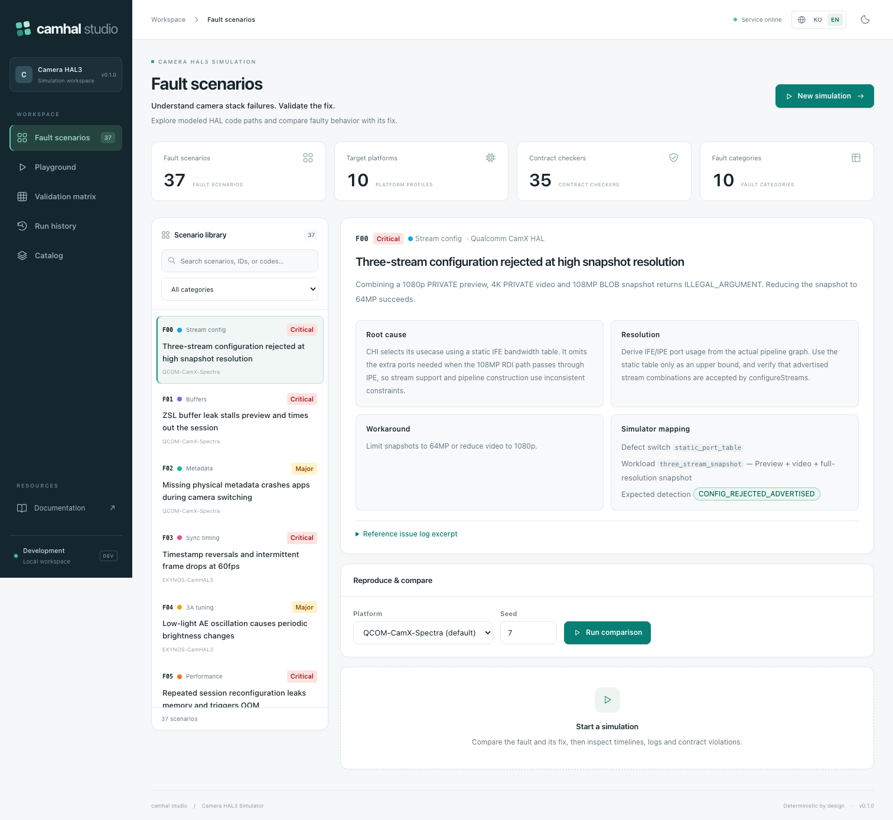
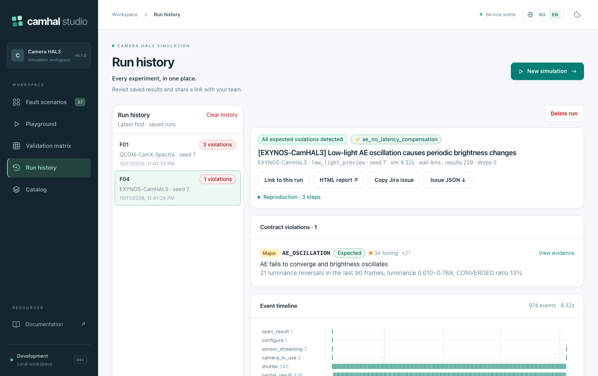
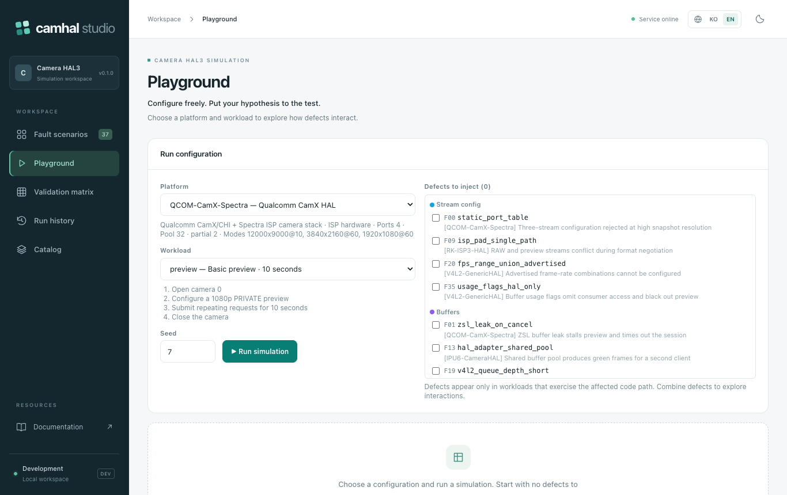

# camera-hal-dev (camhal-sim) — Camera HAL3 discrete-event simulator

<p><a href="README.md" lang="ko">한국어</a> · <strong lang="en">English</strong></p>

Built on the **37 failure scenarios × 10 target platforms** of
[camera-hal-analysis](https://github.com/kos2001/camera-hal-analysis) (a Camera HAL failure-analysis assistant),
this tool models the Android Camera HAL3 stack at the behavior level and injects defects to reproduce the symptoms.
It can be used as a CLI, a Python library, or a web app (FastAPI + React). The package and CLI are named `camhal-sim`.

## Quick start

```sh
git clone https://github.com/kos2001/camera-hal-dev.git
cd camera-hal-dev
bash scripts/serve.sh      # builds the web app and serves everything → http://127.0.0.1:8010
```

For the CLI alone you only need Python ≥ 3.10 (no third-party packages):

```sh
python3 -m camhal_sim fault F01              # reproduce the ZSL buffer leak
python3 -m camhal_sim sweep                  # validate all 37 scenarios
```

See [Quick start (CLI)](#quick-start-cli) and [Web app](#web-app-frontend--backend) for details.

## Screens

| Fault scenarios `#/faults` | Run result `#/history/<id>` |
|---|---|
|  |  |
| 37 scenarios (category filter, search) → symptom, root cause, resolution and simulator mapping; run faulty vs. fixed comparison in one click ([Korean UI](docs/images/faults.png)) | F04 injected: verdict badge, expected violation `AE_OSCILLATION` detected, per-lane event timeline, HTML report and Jira issue export |

| Playground `#/run` | Instrumentation time series (F04) |
|---|---|
|  |  |
| Pick a platform, workload and seed, then combine several defects in one run | AE does not compensate for sensor settling latency, so luminance oscillates around the 0.18 target instead of converging |

- **HAL model**: provider enumeration, hotplug, torch, IPC → configureStreams (port budget, subdev pad
  negotiation, sensor modes, gralloc usage) → processCaptureRequest (sensor SOF, buffer pool, exposure latch,
  timestamps, 3A control loop, ISP latency, partial results) → flush/close.
- **Fault injection**: every defect flips one HAL code path (`sim.defect("...")`). Logs are not faked; the behavior
  changes, so the symptom *happens*. For example, when AE does not compensate for the sensor's 2-frame settling
  delay, luminance really oscillates; when the ZSL cancel path does not return buffers, the pool drains and the
  preview stalls.
- **35 contract checkers**: without knowing which defect was injected, they judge violations using only events the
  framework can observe (callbacks, result metadata, frame statistics, kernel/USB events).
- **Analysis-tool integration**: reproduction results can be exported in the camera-hal-analysis Jira issue format
  (`*대상 플랫폼*`, `*HAL 버전*`, `*고장 분류*` markers) and fed to its recommender.

The simulator core uses only the standard library. The same seed always produces the same result.

## Requirements

| Purpose | Needs |
|---|---|
| Simulator, CLI, tests | Python ≥ 3.10 (no external packages) |
| Backend API | `pip install -r requirements-server.lock` (FastAPI, uvicorn) |
| Frontend | Node.js ≥ 20, npm |

## Quick start (CLI)

```sh
python3 -m camhal_sim list-faults                     # fault catalog
python3 -m camhal_sim fault F01                       # reproduce the ZSL buffer leak
python3 -m camhal_sim fault F01 --fixed               # same steps, no defect → 0 violations
python3 -m camhal_sim sweep                           # all 37: detected when injected, clean when fixed
python3 -m camhal_sim run --platform MTK-Camera3HAL --workload low_light_preview --defect F04
python3 -m camhal_sim fault F24 --html out/f24.html --json out/f24.json --issue out/f24_issue.json
python3 -m unittest discover -s tests                 # regression tests
```

After `pip install -e .` the same commands are available as `camhal-sim ...`.

Example output (`fault F01`; scenario titles and checker messages are in Korean):

```
== [QCOM-CamX-Spectra] ZSL 연사 중 출력 버퍼 미반환으로 프리뷰 정지 후 세션 타임아웃
   platform=QCOM-CamX-Spectra  workload=zsl_burst  seed=7  defects=zsl_leak_on_cancel
   expected=REQUEST_TIMEOUT,BUFFER_LEAK -> DETECTED
   [Critical] BUFFER_LEAK        세션 종료 시 반환되지 않은 버퍼: 미반환 버퍼 30개
   [Critical] REQUEST_TIMEOUT    frame 60 대기 5100ms 후 세션 강제 종료
   [Major   ] STREAM_STALL       2055ms 동안 결과 0장
   -- logcat
       2.2580 W CamX: buffer manager: outstanding=31 max=32, stall
       4.4570 W CameraService: Camera 0: stream stalled, 0 frames in 2055ms
       7.3570 E CameraService: Camera 0: Request timed out, flushing
```

## Web app (frontend + backend)

```sh
bash scripts/serve.sh     # build the frontend, then one server → http://127.0.0.1:8010
bash scripts/dev.sh       # development: backend :8010 (reload) + Vite :5180 (/api proxy) → http://localhost:5180
```

The **KO / EN** buttons in the header switch between Korean and English. Menus, the symptom/root cause/resolution
of all 37 faults, platform/workload/checker descriptions, saved run results and error messages all change
together. Switching the language keeps the current run configuration and result. The first visit follows the
browser language; afterwards the chosen language is remembered. The theme button toggles light and dark mode and
stores the choice. On small screens the menu collapses, and long technical codes and the run form fit the
viewport width.

On first run the scripts automatically install `.venv` (FastAPI, uvicorn) and `web/node_modules`.
GitHub Actions CI runs the Python tests, the frontend build, dependency audit and bilingual browser UI checks,
and the container build with gateway auth-boundary and temporary OIDC login checks on every push/PR.
Server deployment and CI use the pinned versions in `requirements-server.lock`; the frontend uses
`web/package-lock.json`. Direct dependency ranges live in `requirements-server.txt`.

Run results (summary, events, issue JSON, HTML report) are stored in `data/runs.sqlite3` by default.
New runs are stored compressed; older uncompressed records are still readable. Results survive a server restart.
The defaults are at most 1,000 runs in total and 200 per user; both limits are configurable in production.
To change the storage path run `CAMHAL_DB_PATH=/persistent/volume/runs.sqlite3 bash scripts/serve.sh`.
Create a backup while running with
`python3 scripts/backup_runs.py --db data/runs.sqlite3 /backup/path/runs.sqlite3`; it never overwrites an existing
target and verifies the integrity of the copy. The data directory is excluded from Git. The current setup is a
single-server deployment; sharing one SQLite file between several server instances is not supported.
For public deployments, export a host backup with `scripts/export_production_backup.py`.
One process handles at most 4 simulation runs concurrently (2 per user); additional requests get `503` with
`Retry-After: 1`. Request bodies are limited to 32 KiB.

### Browser UI checks

With the built web app and API running, run `npm run test:ui` in `web` for the browser checks. They cover
language/theme persistence, search and category filters, comparison runs, run history, free runs, the validation
matrix, the catalog, injected/fixed verdicts for all 37 faults and missing English translations, the mobile
layout, and error/login messages. The checks create run records, so run them against a server with a separate
database.

```sh
# terminal 1: separate check server
CAMHAL_DB_PATH=/tmp/camhal-ui-smoke.sqlite3 PORT=8126 bash scripts/serve.sh

# terminal 2
cd web
npx playwright install chromium
CAMHAL_BASE_URL=http://127.0.0.1:8126 npm run test:ui
```

Set `CHROME_EXECUTABLE` to an installed Chrome binary to run the checks without a separate Chromium install.
Set `CAMHAL_SCREENSHOTS=/tmp/camhal-screenshots` to save Korean, English, dark-theme and mobile screens as PNG.

### Containers

```sh
docker compose up --build -d
curl http://127.0.0.1:8010/api/ready
```

`compose.yaml` runs a single instance as a non-root user with a read-only root file system and keeps run results
in the `camhal-data` volume. The host port is bound to `127.0.0.1` only and the development auth mode is set
explicitly. Running the container image without Compose requires the production auth settings by default, so the
API does not start without an OIDC configuration.
`compose.production.yaml` for public deployments wires Nginx HTTPS, OAuth2 Proxy login and the app's OIDC token
validation. Domain, TLS certificate and OIDC provider setup are described in the
[production deployment guide](docs/production.md) (Korean). Scaling to several instances first needs a shareable
store and a run job queue.

| Screen | Contents |
|---|---|
| Fault scenarios `#/faults/F04` | List of 37 (category filter, search) → symptom, root cause, resolution, simulator mapping. Selecting one runs the **injected vs. fixed** comparison immediately; change the platform to port the defect to another vendor stack |
| Playground `#/run` | Platform, workload, seed + several defects combined in one run |
| Run history `#/history` | Browse saved results, latest first, and reopen individual results by link |
| Validation matrix `#/sweep` | 74 runs → detection/false-positive table, pass count per category. Clicking a row opens that fault |
| Catalog `#/catalog` | Platform profiles, workload steps and budgets, checkers and their target defects |

Run result view: verdict badge, contract violations (expandable evidence events), per-lane event timeline,
instrumentation time series (luminance, exposure/frame duration, result interval, timestamp Δ, WB error,
provider memory), logcat (level filter, search), paged raw events, HTML report, Jira issue copy/download.

### Backend API (`backend/app.py`, docs at `/docs`)

| Method · path | Description |
|---|---|
| `GET /api/health` · `/api/ready` | Process liveness, storage readiness |
| `GET /api/catalog` | Platforms, workloads, faults, checkers, categories |
| `POST /api/run` | `{platform, workload, defects[], seed}` — defects are switch names or `F01` |
| `POST /api/faults/{id}/run` | `{platform?, seed, fixed}` |
| `POST /api/faults/{id}/compare` | Injected and fixed runs in one call |
| `POST /api/sweep` | `{seed, only?}` validation matrix (cached per seed) |
| `GET /api/runs?limit=50&before=cursor` | Latest runs. Up to 200 per page; use the last item's `cursor` for the next page |
| `GET /api/runs/{rid}` · `/events?kind&offset&limit` · `/issue` · `/report.html` | Run result, paged events, Jira issue, HTML report |
| `DELETE /api/runs/{rid}` · `DELETE /api/runs` | Delete one of your runs, or all of them |

Run results are kept in SQLite, at most 1,000 in total (200 per user). Responses summarize instead of returning
all events: timeline lanes (≤ 800 points per lane), time series (≤ 1200 points) and logs (≤ 3000 lines); raw
events are paged through `/events`. Local mode is for development only; production mode requires OIDC
authentication.

```
backend/   app.py (routes, run store)  serialize.py (result → timeline/time-series summary)
web/src/   api.ts  App.tsx  pages/{Faults,Playground,Sweep,Catalog}Page.tsx
           components/{RunView,charts,ui}.tsx
```

## Commands

| Command | Description |
|---|---|
| `list-platforms` / `list-workloads` / `list-faults [--category]` / `list-checkers` | Browse the catalog |
| `run --platform P --workload W [--defect D ...]` | Run any combination. D is a defect switch name or an ID such as `F01` |
| `fault ID [--fixed] [--platform P]` | Reproduce a fault scenario. `--platform` ports the same defect to another vendor stack |
| `sweep [--seed N] [--only F00 F01] [--json]` | Validation matrix. Exit code 0 when everything passes |
| Common `--seed --logs --html --json --issue` | Seed, number of log lines, HTML timeline, event JSON, Jira issue JSON |

## Structure

```
camhal_sim/
  engine.py        discrete-event kernel (clock, event queue, RNG, observation log)
  model.py         HAL3 types (PixelFormat, Usage, Stream, CaptureRequest, metadata keys, CTS-required keys)
  platforms.py     10 platform profiles (sensor modes, ISP ports, buffer pools, partial count, latencies …)
  hal/
    components.py  BufferPool, Sensor (power sequence, settling delay), AE/AWB, thermal model, lock order, SELinux
    device.py      CameraDevice + session: static metadata, configureStreams, request pipeline, flush/close
    provider.py    ICameraProvider: enumeration, hotplug, torch, IPC epoch, memory/LMK, 3A server, diagnostic port
  framework.py     CameraService: workload API + HAL callback recording + request timeout / stream stall watchdog
  workloads.py     37 reproduction procedures (play the app/test-harness role, use only the framework API)
  checkers.py      35 contract checkers (judge from events only)
  faults.py        fault catalog: reference scenario ↔ defect switch ↔ workload ↔ expected violation codes
  runner.py        run_scenario / run_fault / sweep
  report.py        text, JSON, HTML timeline, Jira issue export
  data/reference_scenarios.json   scenario text imported from the reference repository
backend/                          FastAPI app (app.py routes, serialize.py response summaries)
web/                              React + Vite + TypeScript + Tailwind frontend
scripts/import_reference.py       reference repository → regenerate data JSON
scripts/dev.sh · serve.sh         development servers / single server
tests/test_simulator.py           simulator regression tests
tests/test_backend.py             API tests (skipped when FastAPI is not installed)
```

Layer boundary: **workload → CameraService → HAL (provider/device)**. Defect switches exist only inside the HAL,
and checkers read only `sim.events`. So there is structurally no loop of "look at the defect name and produce the
violation".

## Fault catalog

The original symptom, root cause and resolution text is shown by `list-faults` and in the `fault ID --html` report.

| ID | Category | Default platform | Defect switch | Workload | Expected violation |
|---|---|---|---|---|---|
| F00 | Stream Config | QCOM-CamX-Spectra | `static_port_table` | `three_stream_snapshot` | CONFIG_REJECTED_ADVERTISED |
| F01 | Buffer Management | QCOM-CamX-Spectra | `zsl_leak_on_cancel` | `zsl_burst` | REQUEST_TIMEOUT, BUFFER_LEAK |
| F02 | Metadata | QCOM-CamX-Spectra | `physical_meta_dropped_on_switch` | `logical_zoom_switch` | MISSING_PHYSICAL_METADATA |
| F03 | Sync Timing | EXYNOS-CamHAL3 | `ts_from_pipe_completion` | `video_60fps` | TIMESTAMP_NON_MONOTONIC |
| F04 | 3A Tuning | EXYNOS-CamHAL3 | `ae_no_latency_compensation` | `low_light_preview` | AE_OSCILLATION |
| F05 | Performance | EXYNOS-CamHAL3 | `pipe_teardown_leak` | `session_reconfigure_loop` | MEMORY_GROWTH, PROVIDER_DIED |
| F06 | HAL Interface | MTK-Camera3HAL | `provider_hotplug_cache_stale` | `usb_hotplug` | DEVICE_STATUS_STALE |
| F07 | 3A Tuning | MTK-Camera3HAL | `awb_capture_uses_ambient_gains` | `flash_capture` | AWB_FLASH_MISMATCH |
| F08 | Security | MTK-Camera3HAL | `sepolicy_missing_video_device` | `usb_hotplug` | EXTERNAL_CAMERA_NOT_ENUMERATED |
| F09 | Stream Config | RK-ISP3-HAL | `isp_pad_single_path` | `raw_plus_yuv` | CONFIG_REJECTED_ADVERTISED |
| F10 | 3A Tuning | RK-ISP3-HAL | `aiq_tuning_not_resent` | `aiq_restart_preview` | TUNING_RESET |
| F11 | Sensor Driver | RK-ISP3-HAL | `sensor_power_delay_short` | `cold_boot_open` | OPEN_FAILURE |
| F12 | Performance | IPU6-CameraHAL | `isp_fw_loaded_per_open` | `open_to_first_frame` | FIRST_FRAME_LATENCY |
| F13 | Buffer Management | IPU6-CameraHAL | `hal_adapter_shared_pool` | `dual_client` | FRAME_CONTENT_CORRUPT |
| F14 | Metadata | LIBCAM-AndroidHAL | `static_metadata_incomplete` | `static_metadata_audit` | STATIC_METADATA_MISSING |
| F15 | Request Pipeline | LIBCAM-AndroidHAL | `flush_returns_before_inflight_drained` | `flush_inflight` | RESULT_AFTER_FLUSH |
| F16 | Performance | LIBCAM-AndroidHAL | `softisp_scalar_debayer` | `preview_30fps` | FPS_BELOW_TARGET |
| F17 | HAL Interface | CROS-CameraHAL | `ipc_stale_remote_after_resume` | `suspend_resume` | IPC_TIMEOUT |
| F18 | Sensor Driver | CROS-CameraHAL | `mjpeg_no_default_huffman` | `usb_webcam_mjpeg` | STREAM_STALL |
| F19 | Buffer Management | V4L2-GenericHAL | `v4l2_queue_depth_short` | `high_load_preview` | FRAME_DROP_RATE |
| F20 | Stream Config | V4L2-GenericHAL | `fps_range_union_advertised` | `fps_range_config` | CONFIG_REJECTED_ADVERTISED |
| F21 | Request Pipeline | EMU-CameraHAL | `partial_results_unsequenced` | `partial_results_order` | PARTIAL_OUT_OF_ORDER |
| F22 | Request Pipeline | EMU-CameraHAL | `lock_order_inversion` | `stream_stop_race` | HAL_HANG, PROVIDER_DIED |
| F23 | Performance | AUTO-CamHAL-EVS | `evs_cold_start_on_gear` | `gear_reverse` | FIRST_FRAME_LATENCY |
| F24 | Sync Timing | AUTO-CamHAL-EVS | `evs_free_running_channels` | `surround_view` | MULTICHANNEL_SKEW |
| F25 | Security | QCOM-CamX-Spectra | `privacy_notify_normal_path_only` | `extension_session` | PRIVACY_INDICATOR_MISSING |
| F26 | Security | MTK-Camera3HAL | `close_async_ack` | `app_background` | SENSOR_ACTIVE_AFTER_CLOSE |
| F27 | Security | AUTO-CamHAL-EVS | `diag_path_in_production` | `diag_probe` | UNAUTHENTICATED_FRAME_ACCESS |
| F28 | Metadata | EXYNOS-CamHAL3 | `orientation_read_at_completion` | `rotate_during_capture` | RESULT_SETTING_MISMATCH |
| F29 | Metadata | LIBCAM-AndroidHAL | `scene_mode_handlers_missing` | `scene_mode_sweep` | CONTROL_NOT_APPLIED |
| F30 | HAL Interface | CROS-CameraHAL | `concurrent_combos_unchecked` | `concurrent_open` | CONCURRENT_OPEN_FAILED |
| F31 | HAL Interface | IPU6-CameraHAL | `torch_release_notify_missing` | `torch_availability` | TORCH_CALLBACK_MISSING |
| F32 | Sync Timing | RK-ISP3-HAL | `ts_pipeline_ready_clock` | `record_start_av` | AV_SYNC_DRIFT |
| F33 | Request Pipeline | QCOM-CamX-Spectra | `reprocess_uses_session_params` | `reprocess_capture` | RESULT_SETTING_MISMATCH |
| F34 | Performance | EXYNOS-CamHAL3 | `thermal_silent_downscale` | `long_recording_thermal` | THERMAL_UNREPORTED |
| F35 | Stream Config | V4L2-GenericHAL | `usage_flags_hal_only` | `consumer_usage` | CONSUMER_LOCK_FAILED |
| F36 | Sensor Driver | MTK-Camera3HAL | `mode_switch_stale_exposure` | `sensor_mode_switch` | EXPOSURE_EXCEEDS_FRAME_DURATION |

## Validation status (measured 2026-09-13)

| Item | Result |
|---|---|
| `sweep` with seeds 1·2·3·4·5·7 | 37/37 each — expected violations detected when injected, 0 violations with the same steps once the defect is removed |
| No defects, 37 workloads × 10 platforms (seeds 5, 11) | 0 violations in 740 runs (no false positives) |
| Cross-platform porting | F04 (AE) → MTK and F15 (flush) → EMU detect the same violations |
| Tests | 23 pass (17 simulator + 6 backend API), about 2.5 s |
| camera-hal-analysis integration | Exported issues are parsed correctly by `preprocess.parse_issue` (platform, category, severity, HAL version, symptom). In the BM25 recommender (51-resolution KB), F04, F15, F24 and F25 find the resolution of the same failure as the first hit. F01 misses because that KB has no ZSL resolution |

## Using it with the analysis tool

```sh
python3 -m camhal_sim fault F04 --issue out/F04_issue.json
cd ../camera-hal/camera-hal-analysis
.venv/bin/python - <<'EOF'
import json, sys; sys.path.insert(0, "src")
from preprocess import parse_issue
from recommender import Recommender
kb = [r for r in json.load(open("data/processed_issues.json")) if r.get("root_cause")]
q = parse_issue(json.load(open("../../camera-hal-dev/out/F04_issue.json")))
print(Recommender(kb=kb, method="bm25", signals=False).recommend(q, k=3)["matches"][0]["summary"])
EOF
```

Issues from `fault` mode put the reference scenario's category in `*고장 분류*`. To test the case where the
category is unknown, use `run` mode: the category of the first violation is used instead.

## Adding a new fault

1. Add an `if sim.defect("new_defect"):` branch to the relevant code path in `hal/` (the normal path is the default).
2. If no workload exposes the symptom, add one to `workloads.py` with `@workload(...)`.
3. If it cannot be judged from observed events alone, add a checker to `checkers.py` with `@checker(...)`.
4. Add an entry to `_MAP` in `faults.py`, then run `python3 -m camhal_sim sweep` and the tests.
   The tests also verify that the defect switch string really exists in the HAL code.

When the reference repository's scenarios change, place camera-hal-analysis at
`../camera-hal/camera-hal-analysis` and refresh the JSON with `python3 scripts/import_reference.py [--src path]`
(IDs follow the source order, so adjust `_MAP` as well when inserting in the middle).

## Limits of the model

- Numbers (ISP port counts, pool sizes, latencies, thermal curves, the illuminance-to-luminance model, etc.) are
  **model values that reflect the structure of public stacks, not measurements**. The purpose is not to predict
  absolute performance but to reproduce and verify "does this defect show up as this symptom in this procedure".
- Threads do not actually run. Concurrency (lock deadlocks, partial ordering, channel phase) is modeled as
  overlapping time intervals.
- Image content is represented by statistics (luminance, WB error, checksum, effective resolution, applied
  effects), not pixels.
- AIDL/HIDL interfaces follow method semantics only; there is no binder serialization or thread pool.
- Workload budgets (first frame 1000 ms, 27 fps, 1 % drops, 2 ms channel skew, 40 ms a/v) are taken from the
  requirements in the reference scenario logs. Adjust the budgets in `workloads.py` if your product requirements
  differ.

## License

[MIT](LICENSE) — Copyright (c) 2026 kos2001
