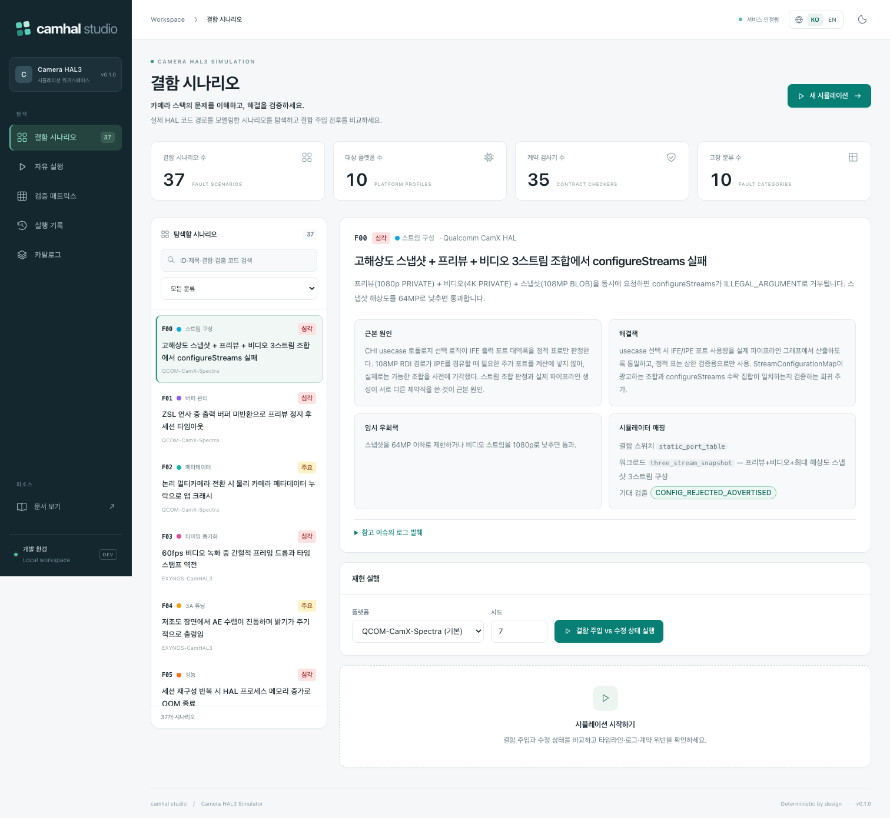
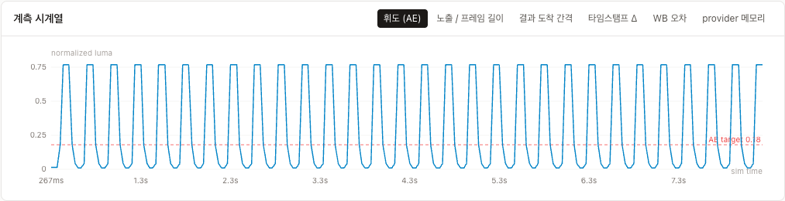

# camhal-sim — Camera HAL3 이산 사건 시뮬레이터

[camera-hal-analysis](https://github.com/kos2001/camera-hal-analysis)(Camera HAL 고장 분석 어시스턴트)의
**고장 시나리오 37종 × 대상 플랫폼 10종**을 기반으로, Android Camera HAL3 스택을 동작 수준에서 모사하고
결함을 주입해 증상을 재현하는 도구다. CLI·Python 라이브러리·웹 앱(FastAPI + React)으로 쓸 수 있다.



[영어 화면 보기](docs/images/faults-en.png)



- **HAL 모델**: provider 열거·핫플러그·토치·IPC → configureStreams(포트 예산, subdev pad 협상,
  센서 모드, gralloc usage) → processCaptureRequest(센서 SOF, 버퍼 풀, 노출 래치, 타임스탬프,
  3A 제어 루프, ISP 지연, partial result) → flush/close.
- **결함 주입**: 결함마다 HAL 코드 경로 하나가 바뀐다(`sim.defect("...")`). 로그를 흉내 내는 게
  아니라 동작이 달라져서 증상이 *발생*한다. 예: AE 가 센서 설정 지연(2프레임)을 보상하지 않으면
  실제로 휘도가 진동하고, ZSL 취소 경로에서 버퍼를 반환하지 않으면 풀이 고갈돼 프리뷰가 멈춘다.
- **계약 검사기 35종**: 어떤 결함이 들어갔는지 모른 채, 프레임워크가 관찰할 수 있는 사건(콜백,
  결과 메타데이터, 프레임 통계, 커널/USB 사건)만으로 위반을 판정한다.
- **분석 도구 연동**: 재현 결과를 camera-hal-analysis 의 Jira 이슈 형식(`*대상 플랫폼*`,
  `*HAL 버전*`, `*고장 분류*` 마커)으로 내보내 추천기 입력으로 쓸 수 있다.

시뮬레이터 코어는 표준 라이브러리만 사용한다. 같은 시드면 결과가 항상 같다.

## 요구 환경

| 용도 | 필요 |
|---|---|
| 시뮬레이터 · CLI · 테스트 | Python ≥ 3.10 (외부 패키지 없음) |
| 백엔드 API | `pip install -r requirements-server.lock` (FastAPI, uvicorn) |
| 프론트엔드 | Node.js ≥ 20, npm |

```sh
git clone https://github.com/kos2001/camera-hal-dev.git
cd camera-hal-dev
bash scripts/serve.sh      # 웹 앱까지 한 번에 → http://127.0.0.1:8010
```

## 빠른 시작 (CLI)

```sh
python3 -m camhal_sim list-faults                     # 결함 카탈로그
python3 -m camhal_sim fault F01                       # ZSL 버퍼 누수 재현
python3 -m camhal_sim fault F01 --fixed               # 같은 절차, 결함 없음 → 위반 0
python3 -m camhal_sim sweep                           # 37종 전부: 주입 시 검출 + 수정 시 무위반
python3 -m camhal_sim run --platform MTK-Camera3HAL --workload low_light_preview --defect F04
python3 -m camhal_sim fault F24 --html out/f24.html --json out/f24.json --issue out/f24_issue.json
python3 -m unittest discover -s tests                 # 회귀 테스트
```

`pip install -e .` 후에는 `camhal-sim ...` 으로도 실행된다.

출력 예 (`fault F01`):

```
== [QCOM-CamX-Spectra] ZSL 연사 중 출력 버퍼 미반환으로 프리뷰 정지 후 세션 타임아웃
   platform=QCOM-CamX-Spectra  workload=zsl_burst  seed=7  defects=zsl_leak_on_cancel
   expected=REQUEST_TIMEOUT,BUFFER_LEAK -> DETECTED
   [Critical] BUFFER_LEAK        세션 종료 시 반환되지 않은 버퍼: 미반환 버퍼 30개
   [Critical] REQUEST_TIMEOUT    frame 60 대기 5100ms 후 세션 강제 종료
   [Major   ] STREAM_STALL       2055ms 동안 결과 0장
   -- logcat
       2.2580 W CamX: buffer manager: outstanding=31 max=32, stall
       4.4570 W CameraService: Camera 0: stream stalled, 0 frames in 2055ms
       7.3570 E CameraService: Camera 0: Request timed out, flushing
```

## 웹 앱 (프론트엔드 + 백엔드)

```sh
bash scripts/serve.sh     # 프론트 빌드 후 단일 서버 → http://127.0.0.1:8010
bash scripts/dev.sh       # 개발: 백엔드 :8010(reload) + Vite :5180(/api 프록시) → http://localhost:5180
```

상단 **KO / EN** 버튼으로 한국어와 영어를 전환한다. 메뉴, 37개 결함의 증상·근본 원인·해결책,
플랫폼·워크로드·검사기 설명, 저장된 실행 결과와 오류 안내가 함께 바뀐다. 언어를 바꿔도 현재
실행 조건과 결과는 유지된다. 첫 방문은 브라우저 언어를 따르고, 이후에는 선택한 언어를 기억한다.
상단 테마 버튼은 밝은 화면과 어두운 화면을 전환하며 선택을 저장한다. 작은 화면에서는 메뉴가
접히고, 긴 기술 코드와 실행 폼은 화면 폭에 맞게 표시된다.

처음 실행 시 `.venv`(FastAPI·uvicorn)와 `web/node_modules` 를 자동 설치한다.
GitHub Actions CI는 Python 테스트, 프론트엔드 빌드, 컨테이너 빌드와 게이트웨이
인증 경계·임시 OIDC 로그인 검사를 push/PR마다 실행한다.
서버 배포와 CI는 `requirements-server.lock`, 프론트엔드는 `web/package-lock.json`의
고정 버전을 사용한다. 직접 의존성 범위는 `requirements-server.txt`에 둔다.

실행 결과(요약, 사건, 이슈 JSON, HTML 리포트)는 기본적으로 `data/runs.sqlite3`에 저장된다.
새 실행 데이터는 압축 저장하고 기존 비압축 기록도 읽는다. 서버를 재시작해도 조회할 수 있으며
기본값은 전체 최대 1,000건, 사용자당 최대 200건이며 운영 환경에서 두 한도를 설정할 수 있다. 저장 경로를 바꾸려면
`CAMHAL_DB_PATH=/영구/볼륨/runs.sqlite3 bash scripts/serve.sh`로 실행한다.
운영 중 백업은 `python3 scripts/backup_runs.py --db data/runs.sqlite3 /백업/경로/runs.sqlite3`로
만든다. 기존 대상 파일은 덮어쓰지 않고 복사본의 무결성을 확인한다. 데이터 디렉터리는
Git에서 제외된다. 현재 단일 서버 운영 구성이므로
여러 서버 인스턴스에서 같은 SQLite 파일을 공유하는 배포는 지원하지 않는다.
공개 배포의 호스트 백업 내보내기는 `scripts/export_production_backup.py`를 사용한다.
시뮬레이션 실행은 한 프로세스에서 동시에 최대 4건(사용자당 2건)까지 처리하고, 초과 요청은
`503`과 `Retry-After: 1`을 반환한다. 요청 본문은 32 KiB까지 허용한다.

### 브라우저 UI 검증

빌드한 웹 앱과 API가 실행 중일 때 `web`에서 `npm run test:ui`로 브라우저 검증을 실행한다.
언어·테마 저장, 검색·분류 필터, 비교 실행·기록 조회·자유 실행·검증 매트릭스·카탈로그,
37개 결함의 주입/수정 판정과 영어 번역 누락, 모바일 화면, 오류·로그인 안내를 확인한다.
검증은 실행 기록을 생성하므로 별도 데이터베이스를 사용하는 서버로 실행한다.

```sh
# 터미널 1: 별도 검증 서버
CAMHAL_DB_PATH=/tmp/camhal-ui-smoke.sqlite3 PORT=8126 bash scripts/serve.sh

# 터미널 2
cd web
npx playwright install chromium
CAMHAL_BASE_URL=http://127.0.0.1:8126 npm run test:ui
```

`CHROME_EXECUTABLE`에 설치된 Chrome 실행 파일을 지정하면 별도 Chromium 설치 없이 검증할 수 있다.
`CAMHAL_SCREENSHOTS=/tmp/camhal-screenshots`를 지정하면 한국어·영어·다크 테마·모바일 화면을 PNG로 저장한다.

### 컨테이너 실행

```sh
docker compose up --build -d
curl http://127.0.0.1:8010/api/ready
```

`compose.yaml`은 단일 인스턴스를 비관리자 권한과 읽기 전용 루트 파일 시스템으로 실행하고,
실행 결과를 `camhal-data` 볼륨에 보관한다. 호스트 포트는 기본적으로 `127.0.0.1`에만
열리며 개발용 인증 모드를 명시한다. 컨테이너 이미지를 Compose 없이 실행하면 기본적으로
운영 인증 설정을 요구하므로 OIDC 설정 없이 API가 시작되지 않는다.
공개 배포용 `compose.production.yaml`은 Nginx HTTPS, OAuth2 Proxy 로그인,
앱의 OIDC 토큰 검증을 연결한다. 도메인·TLS 인증서·OIDC 공급자 설정 방법은
[운영 배포 안내](docs/production.md)에 정리했다. 여러 인스턴스로 확장하려면
공유 가능한 저장소와 실행 작업 큐가 먼저 필요하다.

| 화면 | 내용 |
|---|---|
| 결함 시나리오 `#/faults/F04` | 37종 목록(분류 필터·검색) → 증상·근본원인·해결책·시뮬레이터 매핑. 선택 즉시 **결함 주입 vs 수정 상태** 비교 실행, 플랫폼을 바꿔 다른 벤더 스택에 이식 |
| 자유 실행 `#/run` | 플랫폼·워크로드·시드 + 결함 여러 개 조합 실행 |
| 실행 기록 `#/history` | 저장된 결과를 최신 순으로 조회하고, 개별 결과를 링크로 다시 열기 |
| 검증 매트릭스 `#/sweep` | 74회 실행으로 검출/오탐 표, 분류별 통과 수. 행 클릭 시 해당 결함으로 이동 |
| 카탈로그 `#/catalog` | 플랫폼 프로파일, 워크로드 절차·요구 기준, 검사기와 대상 결함 |

실행 결과 화면: 판정 배지, 계약 위반(근거 사건 펼침), 사건 타임라인(레인별), 계측 시계열(휘도·노출/프레임 길이·
결과 간격·타임스탬프 Δ·WB 오차·provider 메모리), logcat(레벨 필터·검색), 사건 원본 페이징, HTML 리포트,
Jira 이슈 복사/다운로드.

### 백엔드 API (`backend/app.py`, 문서: `/docs`)

| 메서드 · 경로 | 설명 |
|---|---|
| `GET /api/health` · `/api/ready` | 프로세스 생존·저장소 준비 상태 |
| `GET /api/catalog` | 플랫폼·워크로드·결함·검사기·분류 |
| `POST /api/run` | `{platform, workload, defects[], seed}` — defects 는 스위치 이름 또는 `F01` |
| `POST /api/faults/{id}/run` | `{platform?, seed, fixed}` |
| `POST /api/faults/{id}/compare` | 결함 주입/수정 상태 두 실행을 한 번에 |
| `POST /api/sweep` | `{seed, only?}` 검증 매트릭스(시드별 캐시) |
| `GET /api/runs?limit=50&before=커서` | 최신 실행 목록. 최대 200건씩 조회하며 다음 페이지는 마지막 항목의 `cursor`를 사용 |
| `GET /api/runs/{rid}` · `/events?kind&offset&limit` · `/issue` · `/report.html` | 실행 결과·사건 페이징·Jira 이슈·HTML 리포트 |
| `DELETE /api/runs/{rid}` · `DELETE /api/runs` | 자신의 기록 한 건 또는 전체 기록 삭제 |

실행 결과는 SQLite에 전체 최대 1,000건(사용자당 최대 200건)을 보관한다. 응답은 사건 전체 대신
타임라인 레인(레인당 최대 800점)·시계열(최대 1200점)·로그(최대 3000줄)로 요약하고, 원본은
`/events`로 페이지 조회한다. 로컬 모드는 개발 전용이며 운영 모드는 OIDC 인증을 요구한다.

```
backend/   app.py (라우트·실행 저장소)  serialize.py (결과 → 타임라인/시계열 요약)
web/src/   api.ts  App.tsx  pages/{Faults,Playground,Sweep,Catalog}Page.tsx
           components/{RunView,charts,ui}.tsx
```

## 명령

| 명령 | 설명 |
|---|---|
| `list-platforms` / `list-workloads` / `list-faults [--category]` / `list-checkers` | 카탈로그 조회 |
| `run --platform P --workload W [--defect D ...]` | 임의 조합 실행. D 는 결함 스위치 이름 또는 `F01` 같은 ID |
| `fault ID [--fixed] [--platform P]` | 결함 시나리오 재현. `--platform` 으로 다른 벤더 스택에 같은 결함 이식 |
| `sweep [--seed N] [--only F00 F01] [--json]` | 검증 매트릭스. 전부 통과하면 종료코드 0 |
| 공통 `--seed --logs --html --json --issue` | 시드, 로그 줄 수, HTML 타임라인, 사건 JSON, Jira 이슈 JSON |

## 구조

```
camhal_sim/
  engine.py        이산 사건 커널 (시계·사건 큐·난수·관찰 기록)
  model.py         HAL3 타입 (PixelFormat, Usage, Stream, CaptureRequest, 메타데이터 키, CTS 필수 키)
  platforms.py     플랫폼 10종 프로파일 (센서 모드, ISP 포트, 버퍼 풀, partial 수, 지연 …)
  hal/
    components.py  BufferPool, Sensor(전원 시퀀스·설정 지연), AE/AWB, 열 모델, 락 순서, SELinux
    device.py      CameraDevice + 세션: 정적 메타데이터, configureStreams, 요청 파이프라인, flush/close
    provider.py    ICameraProvider: 열거, 핫플러그, 토치, IPC epoch, 메모리/LMK, 3A 서버, 진단 포트
  framework.py     CameraService: 워크로드 API + HAL 콜백 기록 + 요청 타임아웃/스트림 정지 감시
  workloads.py     재현 절차 37종 (앱/테스트 하네스 역할, 프레임워크 API 만 사용)
  checkers.py      계약 검사기 35종 (사건만 보고 판정)
  faults.py        결함 카탈로그: 참고 시나리오 ↔ 결함 스위치 ↔ 워크로드 ↔ 기대 위반 코드
  runner.py        run_scenario / run_fault / sweep
  report.py        텍스트, JSON, HTML 타임라인, Jira 이슈 내보내기
  data/reference_scenarios.json   참고 저장소에서 가져온 시나리오 원문
backend/                          FastAPI 앱 (app.py 라우트, serialize.py 응답 요약)
web/                              React + Vite + TypeScript + Tailwind 프론트엔드
scripts/import_reference.py       참고 저장소 → data JSON 재생성
scripts/dev.sh · serve.sh         개발 서버 / 단일 서버 실행
tests/test_simulator.py           시뮬레이터 회귀 테스트
tests/test_backend.py             API 테스트 (FastAPI 없으면 건너뜀)
```

계층 경계: **워크로드 → CameraService → HAL(provider/device)**. 결함 스위치는 HAL 안에만 있고,
검사기는 `sim.events` 만 읽는다. 따라서 "결함 이름을 보고 위반을 만든다"는 순환이 구조적으로 없다.

## 결함 카탈로그

증상·근본원인·해결책 원문은 `list-faults`, `fault ID --html` 리포트에 함께 나온다.

| ID | 분류 | 기본 플랫폼 | 결함 스위치 | 워크로드 | 기대 위반 |
|---|---|---|---|---|---|
| F00 | Stream Config | QCOM-CamX-Spectra | `static_port_table` | `three_stream_snapshot` | CONFIG_REJECTED_ADVERTISED |
| F01 | Buffer Management | QCOM-CamX-Spectra | `zsl_leak_on_cancel` | `zsl_burst` | REQUEST_TIMEOUT, BUFFER_LEAK |
| F02 | Metadata | QCOM-CamX-Spectra | `physical_meta_dropped_on_switch` | `logical_zoom_switch` | MISSING_PHYSICAL_METADATA |
| F03 | Sync Timing | EXYNOS-CamHAL3 | `ts_from_pipe_completion` | `video_60fps` | TIMESTAMP_NON_MONOTONIC |
| F04 | 3A Tuning | EXYNOS-CamHAL3 | `ae_no_latency_compensation` | `low_light_preview` | AE_OSCILLATION |
| F05 | Performance | EXYNOS-CamHAL3 | `pipe_teardown_leak` | `session_reconfigure_loop` | MEMORY_GROWTH, PROVIDER_DIED |
| F06 | HAL Interface | MTK-Camera3HAL | `provider_hotplug_cache_stale` | `usb_hotplug` | DEVICE_STATUS_STALE |
| F07 | 3A Tuning | MTK-Camera3HAL | `awb_capture_uses_ambient_gains` | `flash_capture` | AWB_FLASH_MISMATCH |
| F08 | Security | MTK-Camera3HAL | `sepolicy_missing_video_device` | `usb_hotplug` | EXTERNAL_CAMERA_NOT_ENUMERATED |
| F09 | Stream Config | RK-ISP3-HAL | `isp_pad_single_path` | `raw_plus_yuv` | CONFIG_REJECTED_ADVERTISED |
| F10 | 3A Tuning | RK-ISP3-HAL | `aiq_tuning_not_resent` | `aiq_restart_preview` | TUNING_RESET |
| F11 | Sensor Driver | RK-ISP3-HAL | `sensor_power_delay_short` | `cold_boot_open` | OPEN_FAILURE |
| F12 | Performance | IPU6-CameraHAL | `isp_fw_loaded_per_open` | `open_to_first_frame` | FIRST_FRAME_LATENCY |
| F13 | Buffer Management | IPU6-CameraHAL | `hal_adapter_shared_pool` | `dual_client` | FRAME_CONTENT_CORRUPT |
| F14 | Metadata | LIBCAM-AndroidHAL | `static_metadata_incomplete` | `static_metadata_audit` | STATIC_METADATA_MISSING |
| F15 | Request Pipeline | LIBCAM-AndroidHAL | `flush_returns_before_inflight_drained` | `flush_inflight` | RESULT_AFTER_FLUSH |
| F16 | Performance | LIBCAM-AndroidHAL | `softisp_scalar_debayer` | `preview_30fps` | FPS_BELOW_TARGET |
| F17 | HAL Interface | CROS-CameraHAL | `ipc_stale_remote_after_resume` | `suspend_resume` | IPC_TIMEOUT |
| F18 | Sensor Driver | CROS-CameraHAL | `mjpeg_no_default_huffman` | `usb_webcam_mjpeg` | STREAM_STALL |
| F19 | Buffer Management | V4L2-GenericHAL | `v4l2_queue_depth_short` | `high_load_preview` | FRAME_DROP_RATE |
| F20 | Stream Config | V4L2-GenericHAL | `fps_range_union_advertised` | `fps_range_config` | CONFIG_REJECTED_ADVERTISED |
| F21 | Request Pipeline | EMU-CameraHAL | `partial_results_unsequenced` | `partial_results_order` | PARTIAL_OUT_OF_ORDER |
| F22 | Request Pipeline | EMU-CameraHAL | `lock_order_inversion` | `stream_stop_race` | HAL_HANG, PROVIDER_DIED |
| F23 | Performance | AUTO-CamHAL-EVS | `evs_cold_start_on_gear` | `gear_reverse` | FIRST_FRAME_LATENCY |
| F24 | Sync Timing | AUTO-CamHAL-EVS | `evs_free_running_channels` | `surround_view` | MULTICHANNEL_SKEW |
| F25 | Security | QCOM-CamX-Spectra | `privacy_notify_normal_path_only` | `extension_session` | PRIVACY_INDICATOR_MISSING |
| F26 | Security | MTK-Camera3HAL | `close_async_ack` | `app_background` | SENSOR_ACTIVE_AFTER_CLOSE |
| F27 | Security | AUTO-CamHAL-EVS | `diag_path_in_production` | `diag_probe` | UNAUTHENTICATED_FRAME_ACCESS |
| F28 | Metadata | EXYNOS-CamHAL3 | `orientation_read_at_completion` | `rotate_during_capture` | RESULT_SETTING_MISMATCH |
| F29 | Metadata | LIBCAM-AndroidHAL | `scene_mode_handlers_missing` | `scene_mode_sweep` | CONTROL_NOT_APPLIED |
| F30 | HAL Interface | CROS-CameraHAL | `concurrent_combos_unchecked` | `concurrent_open` | CONCURRENT_OPEN_FAILED |
| F31 | HAL Interface | IPU6-CameraHAL | `torch_release_notify_missing` | `torch_availability` | TORCH_CALLBACK_MISSING |
| F32 | Sync Timing | RK-ISP3-HAL | `ts_pipeline_ready_clock` | `record_start_av` | AV_SYNC_DRIFT |
| F33 | Request Pipeline | QCOM-CamX-Spectra | `reprocess_uses_session_params` | `reprocess_capture` | RESULT_SETTING_MISMATCH |
| F34 | Performance | EXYNOS-CamHAL3 | `thermal_silent_downscale` | `long_recording_thermal` | THERMAL_UNREPORTED |
| F35 | Stream Config | V4L2-GenericHAL | `usage_flags_hal_only` | `consumer_usage` | CONSUMER_LOCK_FAILED |
| F36 | Sensor Driver | MTK-Camera3HAL | `mode_switch_stale_exposure` | `sensor_mode_switch` | EXPOSURE_EXCEEDS_FRAME_DURATION |

## 검증 현황 (2026-09-13 실측)

| 항목 | 결과 |
|---|---|
| `sweep` 시드 1·2·3·4·5·7 | 각 37/37 — 결함 주입 시 기대 위반 검출, 결함 제거 시 같은 절차에서 위반 0건 |
| 결함 없이 워크로드 37 × 플랫폼 10 (시드 5, 11) | 740회 실행 중 위반 0건 (오탐 없음) |
| 이종 플랫폼 이식 | F04(AE)→MTK, F15(flush)→EMU 에서도 같은 위반 검출 |
| 테스트 | 23개 통과(시뮬레이터 17 + 백엔드 API 6), 약 2.5초 |
| camera-hal-analysis 연동 | 내보낸 이슈를 `preprocess.parse_issue` 가 정상 파싱(플랫폼·분류·심각도·HAL 버전·증상). BM25 추천기(해결 51건 KB)에서 F04·F15·F24·F25 는 1순위로 같은 고장의 해결 사례를 찾음. F01 은 해당 KB 에 ZSL 해결 사례가 없어 빗나감 |

## 분석 도구와 함께 쓰기

```sh
python3 -m camhal_sim fault F04 --issue out/F04_issue.json
cd ../camera-hal/camera-hal-analysis
.venv/bin/python - <<'EOF'
import json, sys; sys.path.insert(0, "src")
from preprocess import parse_issue
from recommender import Recommender
kb = [r for r in json.load(open("data/processed_issues.json")) if r.get("root_cause")]
q = parse_issue(json.load(open("../../camera-hal-dev/out/F04_issue.json")))
print(Recommender(kb=kb, method="bm25", signals=False).recommend(q, k=3)["matches"][0]["summary"])
EOF
```

`fault` 모드의 이슈는 `*고장 분류*` 에 참고 시나리오의 분류를 쓴다. 분류를 모르는 상태를
시험하려면 `run` 모드를 쓰면 첫 위반의 분류가 들어간다.

## 새 결함 추가

1. `hal/` 의 해당 코드 경로에 `if sim.defect("new_defect"):` 분기를 넣는다 (정상 경로가 기본).
2. 증상을 드러내는 워크로드가 없으면 `workloads.py` 에 `@workload(...)` 로 추가한다.
3. 관찰 사건만으로 판정할 수 없으면 `checkers.py` 에 `@checker(...)` 를 추가한다.
4. `faults.py` 의 `_MAP` 에 항목을 넣고 `python3 -m camhal_sim sweep` 과 테스트를 돌린다.
   테스트는 결함 스위치 문자열이 HAL 코드에 실제로 존재하는지도 확인한다.

참고 저장소 시나리오가 바뀌면 camera-hal-analysis 를 `../camera-hal/camera-hal-analysis` 에 두고
`python3 scripts/import_reference.py [--src 경로]` 로 JSON 을 갱신한다
(ID 는 원본 순서 기준이므로 중간 삽입 시 `_MAP` 을 함께 조정).

## 모델의 한계

- 수치(ISP 포트 수, 풀 크기, 지연, 열 곡선, 조도-휘도 모델 등)는 공개 스택 구조를 반영한
  **모델 값이며 실측이 아니다**. 절대 성능 예측이 아니라 "이 결함이 이 절차에서 이 증상으로
  드러나는가"를 재현·검증하는 용도다.
- 스레드는 실제로 돌지 않는다. 동시성(락 교착, partial 순서, 채널 위상)은 시각 겹침으로 모델링했다.
- 영상 내용은 픽셀이 아니라 통계(휘도, WB 오차, checksum, 실효 해상도, 적용 효과)로 표현한다.
- AIDL/HIDL 인터페이스는 메서드 의미만 따르며 바인더 직렬화·스레드풀은 없다.
- 워크로드 예산(첫 프레임 1000ms, fps 27, 드롭 1%, 채널 편차 2ms, a/v 40ms)은 참고 시나리오
  로그의 요구치를 옮긴 것이다. 제품 요구가 다르면 `workloads.py` 의 budgets 를 조정한다.
